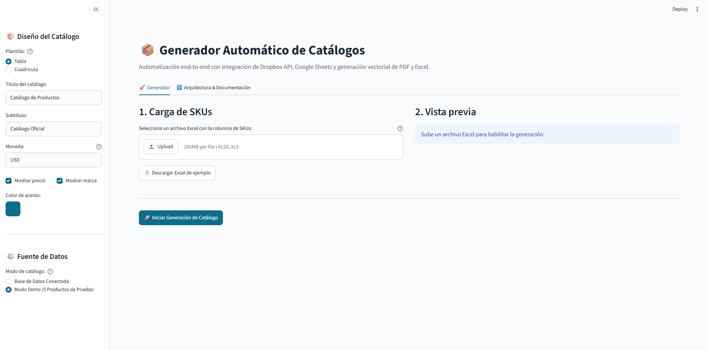
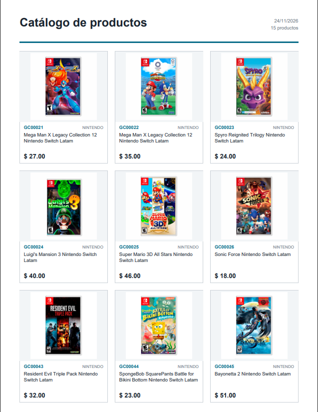
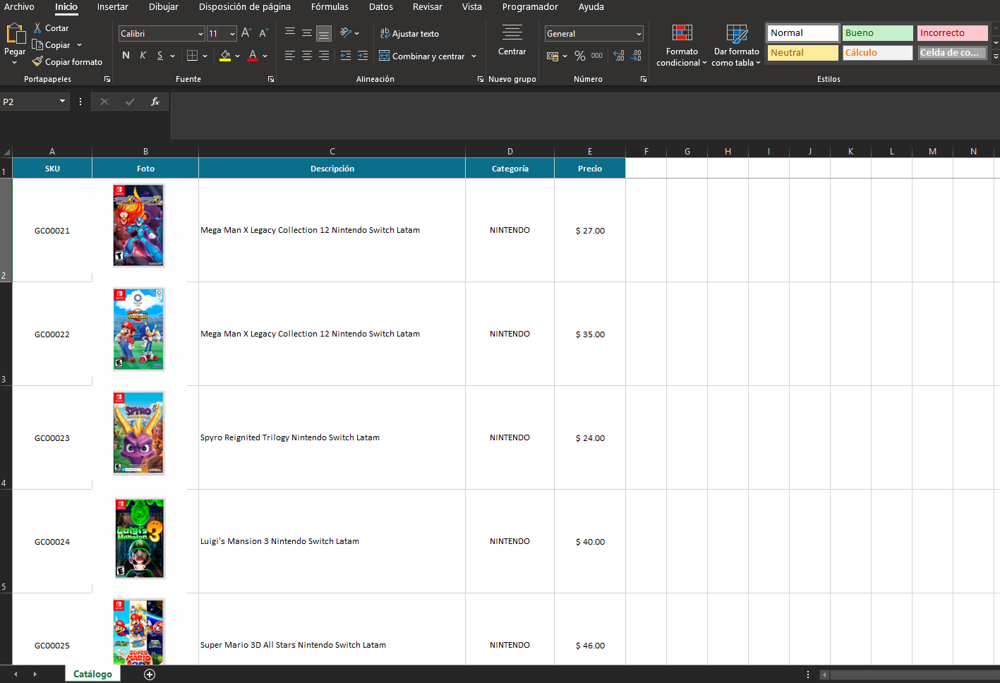
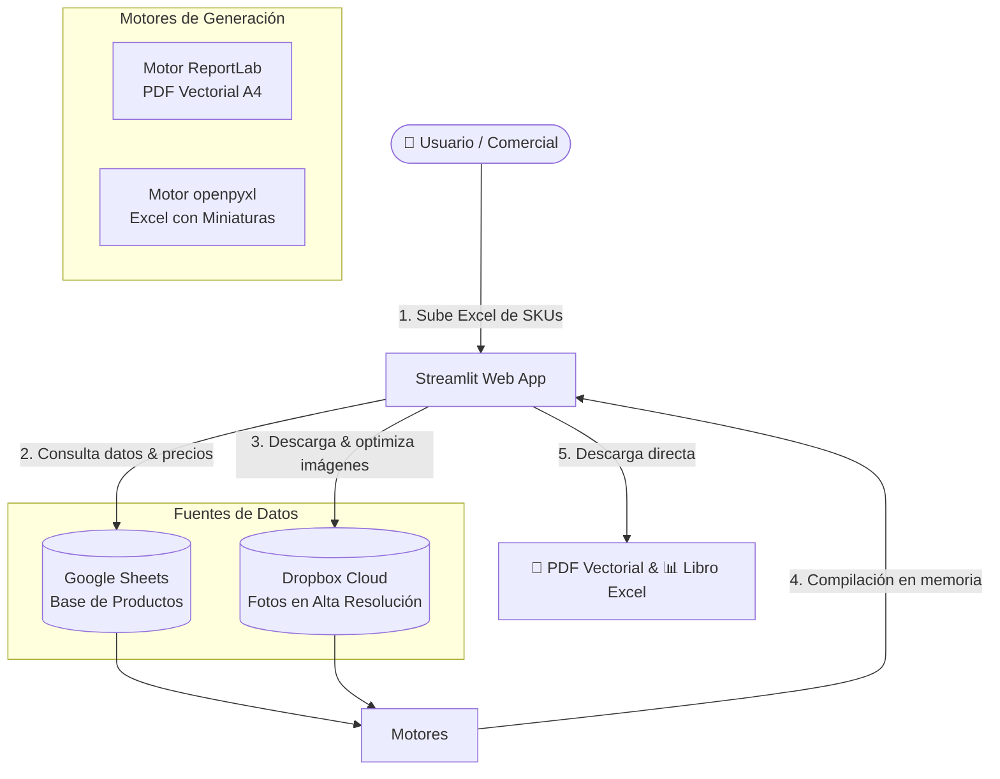

# 📦 Generador Automático de Catálogos (PDF & Excel)

> **Automatización empresarial integral** para sincronizar bases de datos comerciales en Google Sheets, descargar fotografías de alta resolución vía Dropbox API y compilar catálogos vectoriales en PDF y libros de Excel formateados con imágenes embebidas.

---

## 💼 Impacto de Negocio

* **Problema:** El equipo comercial y de diseño invertía entre **3 y 5 horas por catálogo** buscando fotografías en carpetas compartidas, copiando especificaciones técnicas y maquetando productos manualmente, con alto riesgo de errores tipográficos en precios o códigos.
* **Solución:** Una herramienta web interactiva que genera catálogos completos listos para impresión y distribución comercial en **menos de 30 segundos**.

---

## 📸 Demostración Visual

### 💻 Interfaz Web de la Aplicación

### 📄 Resultados Generados (PDF & Excel)
| Catálogo en PDF Vectorial | Libro Excel con Fotos Embebidas |
| :---: | :---: |
|  |  |

---

## 🏗️ Arquitectura del Sistema

---

## ✨ Características Principales

* **Doble Plantilla Dinámica:**
  * **Plantilla Cuadrícula (Grid):** Visual tipo e-commerce configurable en 2, 3 o 4 columnas por página.
  * **Plantilla Tabla:** Formato denso ideal para listas de precios técnicas y cotizaciones corporativas.
* **Integración Dropbox OAuth2:**
  * Uso de *Refresh Tokens* para sesiones seguras de larga duración.
  * Búsqueda por SKU y selección automática de la mejor toma disponible.
  * Procesamiento en memoria de miniaturas con `Pillow` (sin saturar almacenamiento local).
* **Base de Datos Centralizada (Google Sheets):**
  * Sincronización en tiempo real con la hoja maestra de productos (SKU, Nombre, Precios, Marca/Categoría).
* **Generación Vectorial Estricta (ReportLab):**
  * Cálculo dinámico de ancho tipográfico (`stringWidth`) para cortes de línea y elipsis perfectas sin desbordes.
  * Compatibilidad con colores corporativos personalizados (`HexColor`).
* **Excel con Imágenes Reales Embebidas (`openpyxl`):**
  * Inserción y redimensionado proporcional de fotografías dentro de las celdas.

---

## 🛠️ Stack Tecnológico

| Capa | Tecnología |
| :--- | :--- |
| **Frontend / Interfaz** | [Streamlit](https://streamlit.io/) |
| **Lenguaje Core** | Python 3.10+ |
| **APIs de Integración** | Dropbox API v2 (`dropbox`), Google Sheets (`gspread`, `google-auth`) |
| **Procesamiento de Imágenes** | [Pillow (PIL)](https://python-pillow.org/) |
| **Generación de Documentos** | [ReportLab](https://www.reportlab.com/) (PDFs), [openpyxl](https://openpyxl.readthedocs.io/) (XLSX) |
| **Gestión de Datos** | [Pandas](https://pandas.pydata.org/) |

---

## 🗺️ Roadmap Técnico (Próximos Pasos - v2.0)

- [ ] **Desacoplamiento Fullstack:** Migración del backend a **FastAPI** para ofrecer endpoints REST `/api/v1/generate-catalog`.
- [ ] **Frontend a Medida:** Interfaz moderna desarrollada con **HTML5, TailwindCSS y JavaScript**.
- [ ] **Webhooks en Tiempo Real:** Generación automática disparada por cambios de inventario en Google Sheets o ERP.
- [ ] **Cache Distribuido:** Implementación de Redis para cachear miniaturas frecuentes y reducir llamadas a la API de Dropbox.

---

## 📄 Licencia
Distribuido bajo la Licencia MIT. Consulta el archivo `LICENSE` para más detalles.
